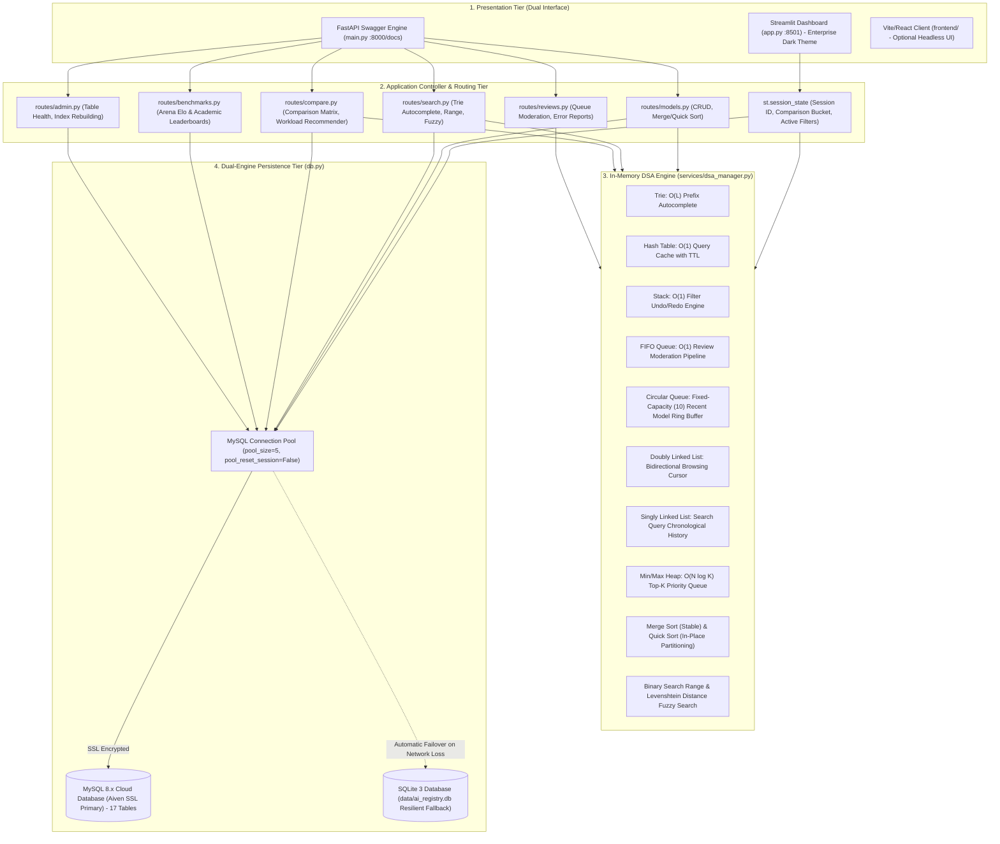
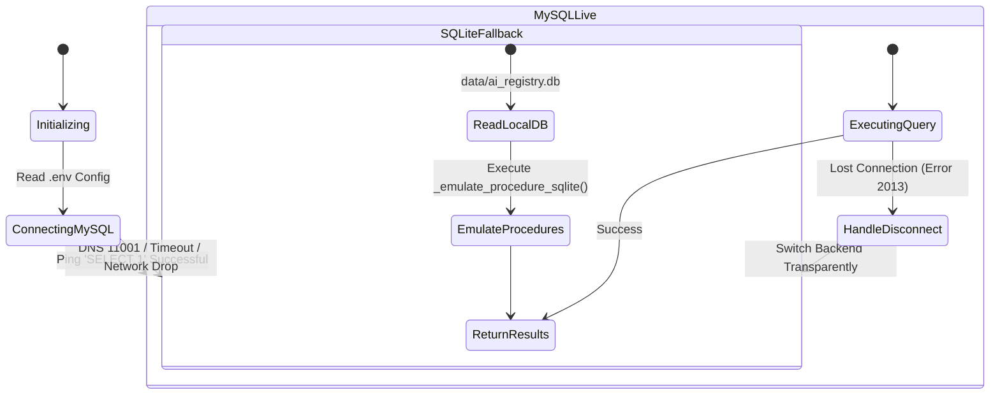

# ⚡ NEXUS AI — Master Engineering Specification & Complete Project Encyclopedia

> **System Name**: NEXUS AI (Frontier Model Intelligence & Enterprise Registry)  
> **Version**: 2.4 Enterprise  
> **Primary Purpose**: Comprehensive Benchmarking, Capability Auditing, Cost Optimization, and Relational Registry for Frontier AI Foundation Models  
> **Target Audience**: AI Engineers, ML Researchers, Enterprise System Architects, and Academic Evaluators (DBMS & DSA)  
> **Document Scope**: Exhaustive line-by-line, table-by-table, algorithm-by-algorithm reference manual.

---

## 📑 Master Table of Contents
1. [Core Mission & The Real-World Problem](#1-core-mission--the-real-world-problem)
2. [End-to-End System Architecture](#2-end-to-end-system-architecture)
3. [Exhaustive DBMS Specification (17 Tables, 6 Views, 3 Triggers, 5 Procedures, 16 Indexes)](#3-exhaustive-dbms-specification)
4. [Exhaustive DSA Specification (12 Algorithms & Data Structures)](#4-exhaustive-dsa-specification)
5. [The 7 Functional Workspaces (Step-by-Step User & Data Flows)](#5-the-7-functional-workspaces)
6. [Complete REST API Contract (18 FastAPI Endpoints)](#6-complete-rest-api-contract)
7. [The API Gateway Snippet Generator (Demystified)](#7-the-api-gateway-snippet-generator)
8. [Mathematical & Financial Models](#8-mathematical--financial-models)
9. [Resilience & Failover Engine (Dual MySQL/SQLite Engine)](#9-resilience--failover-engine)
10. [Automated Verification & Test Suite](#10-automated-verification--test-suite)
11. [Operational Runbook & Quick Commands](#11-operational-runbook--quick-commands)

---

## 1. Core Mission & The Real-World Problem

### 1.1 The Industry Dilemma
Modern software engineering has shifted from training models from scratch to orchestrating frontier foundation models (LLMs) via APIs. However, developers and enterprises face an overwhelming operational challenge:
- **Cost Volatility**: Model pricing ranges from \$0.00 (open weights/free tiers) to \$30.00+ per 1M tokens. Selecting the wrong model for high-throughput batch workloads can cost thousands of wasted dollars per week.
- **Context Asymmetry**: Context windows vary from 8,000 tokens (legacy) to 2,000,000 tokens (e.g., Gemini 1.5 Pro). Processing a 200-page document requires careful verification of model context boundaries.
- **Capability Nuances**: Some models excel at step-by-step mathematical reasoning (Chain-of-Thought), others at multi-turn tool calling (JSON mode / function calling), and others at multimodal vision.
- **Fragmented Documentation**: OpenAI, Anthropic, Google, Meta, Mistral, and DeepSeek all maintain separate developer documentation, different pricing units, and separate release cycles.

### 1.2 The NEXUS AI Solution
NEXUS AI aggregates frontier model metadata into a single, cohesive, enterprise-grade intelligence platform:
1. **Normalized Persistence**: Stores all models, lineage families, vendors, token pricing histories, academic benchmark results, and rate limits in a strict **Third Normal Form (3NF)** relational database.
2. **In-Memory Optimization**: Offloads real-time operations (autocomplete, catalog sorting, filter undo, recently viewed buffers, and moderation queues) to **12 pure-Python Data Structures & Algorithms (DSA)**, eliminating redundant database strain.
3. **Enterprise SaaS Experience**: Provides a dark-mode interface inspired by Linear, Vercel, Stripe Dashboard, and Bloomberg Terminal, complete with live monthly spend forecasting, head-to-head matrix comparisons, and ready-to-run API code snippets.

---

## 2. End-to-End System Architecture



---

## 3. Exhaustive DBMS Specification

The database layer is constructed with mathematical rigor in **Third Normal Form (3NF)**. Every non-key column is strictly non-transitively dependent on the primary key ($X \rightarrow Y$).

### 3.1 The 17 Relational Tables

#### 1. `providers` (AI Laboratories & Organizations)
- **Primary Key**: `provider_id` (INT, AUTO_INCREMENT)
- **Columns**:
  - `name` (VARCHAR(100), UNIQUE, NOT NULL): Corporate or lab identity (e.g., `'OpenAI'`, `'Anthropic'`, `'Google'`, `'Meta'`, `'Mistral AI'`, `'DeepSeek'`, `'xAI'`).
  - `headquarters_country` (VARCHAR(60)): Country of origin (e.g., `'United States'`, `'France'`, `'China'`).
  - `founded_year` (INT): Foundation year (CHECK: `BETWEEN 1900 AND 2100`).
  - `website` (VARCHAR(255)): Official URL.
  - `description` (TEXT): Corporate background and research mission.
  - `created_at`, `updated_at` (TIMESTAMP).

#### 2. `model_families` (Lineage Groups)
- **Primary Key**: `family_id` (INT, AUTO_INCREMENT)
- **Foreign Keys**: `provider_id` $\rightarrow$ `providers(provider_id)` ON DELETE CASCADE.
- **Constraints**: `UNIQUE KEY uq_family_provider_name (provider_id, name)`.
- **Columns**:
  - `name` (VARCHAR(100), NOT NULL): Family brand (e.g., `'GPT'`, `'Claude'`, `'Gemini'`, `'Llama'`, `'DeepSeek-V'`).
  - `is_open_source` (BOOLEAN, DEFAULT FALSE): Identifies open weights vs proprietary.
  - `github_url` (VARCHAR(500)): Repository link for open weights.
  - `description` (TEXT).

#### 3. `model_versions` (Specific Model Releases)
- **Primary Key**: `version_id` (INT, AUTO_INCREMENT)
- **Foreign Keys**:
  - `family_id` $\rightarrow$ `model_families(family_id)` ON DELETE CASCADE.
  - `parent_version_id` $\rightarrow$ `model_versions(version_id)` ON DELETE SET NULL (Self-referential recursive relationship tracking model fine-tunes or iterations).
- **Constraints**: `UNIQUE(external_id)`.
- **Columns**:
  - `version_name` (VARCHAR(200), NOT NULL): Commercial name (e.g., `'GPT-4o'`, `'Claude 3.5 Sonnet'`).
  - `external_id` (VARCHAR(200), UNIQUE): API call string (e.g., `'gpt-4o-2024-08-06'`, `'claude-3-5-sonnet-20241022'`).
  - `release_date` (DATE): Official launch timestamp.
  - `status` (ENUM('active','deprecated','beta','discontinued')): Production readiness.
  - `context_length` (INT): Maximum input token ingest limit.
  - `max_output_tokens` (INT): Maximum generated token limit per single request.
  - `input_modalities` (VARCHAR(200)): Modalities accepted (e.g., `'text, image'`).
  - `output_modalities` (VARCHAR(200)): Modalities produced (e.g., `'text'`).
  - `tokenizer` (VARCHAR(100)): Tokenizer standard (e.g., `'cl100k_base'`, `'o200k_base'`).
  - `is_free`, `has_free_tier` (BOOLEAN): Commercial access flags.
  - `supports_tool_use`, `supports_reasoning`, `supports_structured_output` (BOOLEAN): Capability flags.
  - `description` (TEXT).

#### 4. `pricing_history` (Historical Pricing Ledger)
- **Primary Key**: `pricing_id` (INT, AUTO_INCREMENT)
- **Foreign Keys**: `version_id` $\rightarrow$ `model_versions(version_id)` ON DELETE CASCADE.
- **Constraints**: `UNIQUE KEY uq_ph_version_date (version_id, effective_date)`, `CHECK (input_price >= 0)`, `CHECK (output_price >= 0)`.
- **Columns**:
  - `input_price_per_1m_tokens` (DECIMAL(12,4), NOT NULL): Cost per 1,000,000 input prompt tokens in USD.
  - `output_price_per_1m_tokens` (DECIMAL(12,4), NOT NULL): Cost per 1,000,000 generated output tokens in USD.
  - `effective_date` (DATE, NOT NULL): Date the price schedule went live.
  - `currency` (VARCHAR(3), DEFAULT 'USD').

#### 5. `api_endpoints` (Production API Gateway Specs)
- **Primary Key**: `endpoint_id` (INT, AUTO_INCREMENT)
- **Foreign Keys**: `version_id` $\rightarrow$ `model_versions(version_id)` ON DELETE CASCADE (UNIQUE).
- **Columns**:
  - `base_url` (VARCHAR(500), NOT NULL): Base API URL (e.g., `'https://api.openai.com/v1'`).
  - `auth_type` (ENUM('api_key','oauth','none')): Authentication header protocol.
  - `documentation_url` (VARCHAR(500)): Developer documentation link.
  - `rate_limit_rpm` (INT): Rate limit quota in Requests Per Minute.

#### 6. `capabilities` (Master Capabilities Catalogue)
- **Primary Key**: `capability_id` (INT, AUTO_INCREMENT)
- **Columns**:
  - `name` (VARCHAR(100), UNIQUE, NOT NULL): e.g., `'Function Calling'`, `'Multimodal Vision'`, `'Chain-of-Thought Reasoning'`.
  - `category` (VARCHAR(50)): e.g., `'agentic'`, `'multimodal'`, `'coding'`.
  - `description` (TEXT).

#### 7. `model_capabilities` (M:N Capability Junction)
- **Primary Key**: Composite `(version_id, capability_id)`
- **Foreign Keys**: Both cascade on delete.
- **Columns**: `proficiency` (ENUM('basic','good','excellent')): Verified skill tier.

#### 8. `benchmarks` (Standard Academic Evaluations)
- **Primary Key**: `benchmark_id` (INT, AUTO_INCREMENT)
- **Columns**:
  - `name` (VARCHAR(100), UNIQUE, NOT NULL): e.g., `'Chatbot Arena Elo'`, `'MMLU'`, `'HumanEval'`, `'GSM8K'`, `'GPQA Diamond'`.
  - `full_name` (VARCHAR(255)): Formal academic paper name.
  - `category` (VARCHAR(50)): e.g., `'general'`, `'coding'`, `'math'`, `'reasoning'`.
  - `max_score` (DECIMAL(10,2)): Maximum scale boundary (e.g., 100.00 for percentage tests, 1500+ for Elo).
  - `source_url` (VARCHAR(500)).

#### 9. `benchmark_scores` (Quantitative Model Evaluations)
- **Primary Key**: `score_id` (INT, AUTO_INCREMENT)
- **Foreign Keys**: `version_id` $\rightarrow$ `model_versions`, `benchmark_id` $\rightarrow$ `benchmarks`.
- **Constraints**: `UNIQUE KEY uq_bs_version_benchmark (version_id, benchmark_id)`.
- **Columns**: `score` (DECIMAL(10,4), NOT NULL), `evaluated_date` (DATE), `source` (VARCHAR(255)).

#### 10. `use_cases` (Enterprise Business Workloads)
- **Primary Key**: `use_case_id` (INT, AUTO_INCREMENT)
- **Columns**:
  - `name` (VARCHAR(100), UNIQUE, NOT NULL): e.g., `'Software Engineering & Coding'`, `'Customer Support Agent'`, `'Financial Data Extraction & Analysis'`, `'Academic Research & Literature Review'`, `'Creative Writing & Scriptwriting'`, `'Autonomous Task Execution'`.
  - `category` (VARCHAR(50)).

#### 11. `model_use_cases` (M:N Workload Suitability Junction)
- **Primary Key**: Composite `(version_id, use_case_id)`
- **Constraints**: `CHECK (suitability_score BETWEEN 0.00 AND 1.00)`.
- **Columns**: `suitability_score` (DECIMAL(3,2)), `notes` (TEXT).

#### 12. `tags` & 13. `model_tags` (Categorical Indexing)
- Flexible tagging schema allowing models to be tagged with labels like `'Open-Source'`, `'MoE'`, `'Proprietary'`, `'Budget-Friendly'`, `'Long-Context'`.

#### 14. `user_reviews` (Community Developer Audits)
- **Primary Key**: `review_id` (INT, AUTO_INCREMENT)
- **Constraints**: `CHECK (rating BETWEEN 1 AND 5)`.
- **Columns**: `version_id`, `reviewer_name`, `rating`, `title`, `review_text`, `is_verified`, `is_approved`, `created_at`.

#### 15. `error_reports` (Incident & Hallucination Audits)
- **Primary Key**: `report_id` (INT, AUTO_INCREMENT)
- **Columns**:
  - `error_type` (ENUM('hallucination','refusal','incorrect','timeout','formatting','safety','other')).
  - `severity` (ENUM('low','medium','high','critical')).
  - `description` (TEXT), `status` (ENUM('open','investigating','confirmed','resolved','wont_fix')).
  - `resolved_at` (TIMESTAMP, auto-managed by database trigger).

#### 16. `comparison_logs` (Side-by-Side Audit Trail)
- Logs telemetry whenever users compare two models head-to-head (`version_id_1`, `version_id_2`, `winner_version_id`, `comparison_criteria`, `created_at`).

#### 17. `search_logs` (Query & Session Telemetry)
- Tracks search keyword history, active JSON filters applied, returned record counts, and timestamps per `session_id`.

---

### 3.2 The 6 Pre-Computed SQL Views

1. **`v_model_full_details`**:
   Unifies `model_versions`, `model_families`, `providers`, and the single most recent row from `pricing_history` (correlated subquery on `MAX(effective_date)`). Eliminates the need for 4-table joins in frontend scripts.
2. **`v_top_rated_models`**:
   Computes aggregated `avg_rating` (rounded to 2 decimal places) and `review_count` for all models where `is_approved = TRUE`.
3. **`v_free_models`**:
   Filters models where `is_free = TRUE` or where latest pricing is exactly \$0.0000 input and \$0.0000 output.
4. **`v_model_benchmark_summary`**:
   A PIVOT view aggregating categories (`general`, `coding`, `math`, `reasoning`, `creative`) using `MAX(CASE WHEN ...)` to display all benchmark scores per model on a single horizontal row.
5. **`v_provider_statistics`**:
   Vendor-level roll-up aggregating distinct family counts, active release counts, free version counts, average input prices, and min/max price spreads.
6. **`v_model_comparison_ready`**:
   Pre-formats a denormalized comparison payload with string-aggregated capability lists (`GROUP_CONCAT(c.name)`) and benchmark scores ready for instantaneous dual-card rendering.

---

### 3.3 The 3 Database Triggers

1. **`trg_validate_pricing`** (*BEFORE INSERT on `pricing_history`*):
   Validates financial integrity. If either `input_price_per_1m_tokens < 0` or `output_price_per_1m_tokens < 0`, it raises a `SIGNAL SQLSTATE '45000'` with the message: *"Input/Output price per 1M tokens cannot be negative."*
2. **`trg_review_rating_check`** (*BEFORE INSERT on `user_reviews`*):
   Sanitizes input by automatically trimming whitespace from `reviewer_name` via `SET NEW.reviewer_name = TRIM(NEW.reviewer_name)` and ensures ratings adhere strictly to $1 \le \text{rating} \le 5$.
3. **`trg_error_resolve_timestamp`** (*BEFORE UPDATE on `error_reports`*):
   Automates timestamping. When the status transitions to `'resolved'` or `'wont_fix'`, the trigger sets `SET NEW.resolved_at = NOW()`.

---

### 3.4 The 5 Stored Procedures

1. **`sp_search_models(p_query, p_free_only, p_min_context, p_max_price, p_capability)`**:
   Dynamic multi-parameter search engine evaluating SQL `LIKE` statements across version names, family names, and external IDs, while applying context thresholds, price ceilings, and capability presence subqueries.
2. **`sp_compare_models(p_version_id_1, p_version_id_2)`**:
   Automates audit logging into `comparison_logs` and returns two simultaneous result sets: (1) Basic specifications, pricing, and capabilities for both models; (2) Side-by-side benchmark score comparisons and percentage scales.
3. **`sp_get_top_models(p_criteria, p_limit)`**:
   Dynamic ranking procedure sorting by `'rating'`, `'cheapest'`, `'context_length'`, or `'newest'` with dynamic `CASE` order evaluation.
4. **`sp_recommend_model(p_use_case, p_max_budget, p_min_context)`**:
   Calculates optimal models for a target enterprise use case by joining `model_use_cases`, verifying budget ceilings, and sorting by `suitability_score DESC`.
5. **`sp_provider_report(p_provider_name)`**:
   Generates a 3-part portfolio audit for any target AI lab: (1) Overview stats, (2) Model catalog with ratings and review counts, (3) Capability frequency distribution across all lab models.

---

## 4. Exhaustive DSA Specification

The in-memory engine (`dsa/` and `services/dsa_manager.py`) consists of 12 distinct implementations in pure Python, providing high-efficiency data handling:

### 1. Trie (Prefix Tree) — `dsa/trie.py`
- **Data Structure**: `TrieNode` containing a children dictionary `Dict[str, TrieNode]`, an `is_end_of_word` boolean flag, and a reference payload `data: Any`.
- **Time Complexity**: Insertion $O(L)$, Exact Search $O(L)$, Prefix Suggestion $O(P + K)$ where $L$ is string length, $P$ is prefix length, and $K$ is total matched descendants.
- **Role in Platform**: Powers the instant search suggestion bar. As the user types `"cla"`, the Trie traverses to the `"a"` node in 3 pointer hops and extracts `Claude 3.5 Sonnet`, `Claude 3 Opus`, and `Claude 3.5 Haiku` in sub-millisecond time without querying the database.

### 2. Hash Table (Custom with Separate Chaining & TTL) — `dsa/hash_table.py`
- **Data Structure**: Array of fixed capacity (default 128) containing singly-linked buckets of `HashNode(key, value, expires_at)`. Uses polynomial hash code modulo table capacity.
- **Time Complexity**: $O(1)$ average insertion, retrieval, and deletion; $O(N)$ worst-case under severe hash collisions.
- **Role in Platform**: Caches expensive database query outputs (e.g., aggregate KPI statistics and benchmark distribution lists) with a 300-second Time-To-Live (TTL).

### 3. Stack (LIFO) — `dsa/stack.py`
- **Data Structure**: Dynamic singly-linked stack containing `StackNode(data, next)` with pointer to the top.
- **Time Complexity**: Push $O(1)$, Pop $O(1)$, Peek $O(1)$.
- **Role in Platform**: Filter state undo engine. Every time a user changes a filter slider, multiselect, or checkbox, a snapshot dictionary is pushed onto the session's filter stack. Clicking **"⏪ Undo Previous Filter (DSA)"** pops the previous state and restores the dashboard.

### 4. FIFO Queue — `dsa/queue_ds.py`
- **Data Structure**: Linked queue with explicit `head` and `tail` pointers.
- **Time Complexity**: Enqueue $O(1)$, Dequeue $O(1)$, Peek $O(1)$.
- **Role in Platform**: Review moderation pipeline. When community developers submit reviews, they enter the tail of the moderation queue. System administrators process reviews from the head of the queue in strict First-In, First-Out arrival order.

### 5. Circular Queue (Ring Buffer) — `dsa/circular_queue.py`
- **Data Structure**: Fixed-capacity array of size 10 with `head`, `tail`, and `size` pointer modulo wrapping:
  $$\text{tail} = (\text{tail} + 1) \pmod{\text{capacity}}$$
- **Time Complexity**: Enqueue $O(1)$, Dequeue $O(1)$. Overwrites oldest entries when full.
- **Role in Platform**: Tracks the "Recently Viewed Models" history in the sidebar. Provides fixed memory guarantees ($O(1)$ space) regardless of session duration.

### 6. Doubly Linked List — `dsa/doubly_linked_list.py`
- **Data Structure**: Nodes with bidirectional pointers: `Node(data, prev, next)`. Maintains an active traversal cursor `current_node`.
- **Time Complexity**: Step forward $O(1)$, Step backward $O(1)$, Append $O(1)$.
- **Role in Platform**: Powers forward/backward model navigation history.

### 7. Singly Linked List — `dsa/linked_list.py`
- **Data Structure**: Sequential linked chain `Node(data, next)`.
- **Time Complexity**: Append $O(1)$ with tail pointer, Traversal $O(N)$.
- **Role in Platform**: Stores chronological search query logs per session.

### 8. Priority Queue (Min-Heap & Max-Heap) — `dsa/priority_queue.py`
- **Data Structure**: Complete binary tree backed by a dynamic array. Parent-child relationships satisfy:
  $$\text{parent}(i) = \lfloor (i - 1) / 2 \rfloor, \quad \text{left}(i) = 2i + 1, \quad \text{right}(i) = 2i + 2$$
- **Time Complexity**: Push $O(\log N)$, Pop $O(\log N)$, Top-K Extraction $O(N \log K)$.
- **Role in Platform**: Extracts top $K$ models by price (Min-Heap) or rating (Max-Heap). For a catalog of $N = 10,000$ models, extracting the top 5 cheapest models takes only $\sim 50$ operations compared to $10,000 \log(10,000) \approx 133,000$ operations for a full sort.

### 9. Merge Sort (Stable Sorting) — `dsa/sorting.py`
- **Algorithm**: Recursive divide-and-conquer. Splits array into halves ($O(\log N)$ splits) and merges them stably using auxiliary space ($O(N)$ space).
- **Time Complexity**: Best, Average, and Worst Case: $O(N \log N)$.
- **Role in Platform**: Primary catalog sorting engine. Preserves the original relative order of models with equal pricing when sorting by multiple keys.

### 10. Quick Sort (In-Place Partitioning) — `dsa/sorting.py`
- **Algorithm**: In-place Lomuto/Hoare partitioning using median-of-three pivot selection.
- **Time Complexity**: $O(N \log N)$ average, $O(N^2)$ worst-case under pre-sorted input without randomized pivot. Auxiliary space $O(\log N)$.
- **Role in Platform**: Used for high-speed benchmark score sorting where stability is not required.

### 11. Binary Search & Binary Search Range — `dsa/searching.py`
- **Algorithm**: Operates on pre-sorted arrays by iteratively halving the search window ($[\text{low}, \text{high}]$).
- **Time Complexity**: Exact Lookup $O(\log N)$, Range Query $O(\log N + K)$ where $K$ is the number of matching elements.
- **Role in Platform**: Finds exact models by name in $\le 7$ comparisons out of 100 models, and extracts all models within a specific price bracket $[\$0.50, \$2.00]$.

### 12. Fuzzy Search (Levenshtein Distance) — `dsa/searching.py`
- **Algorithm**: 2D dynamic programming computing edit distance (insertions, deletions, substitutions):
  $$D[i, j] = \min \begin{cases} D[i-1, j] + 1 \\ D[i, j-1] + 1 \\ D[i-1, j-1] + \text{cost} \end{cases}$$
- **Time Complexity**: $O(M \times N)$ per candidate string.
- **Role in Platform**: Typo-tolerant model search (e.g., typing `"gpt4"` or `"dseek"` successfully matches `"GPT-4o"` and `"DeepSeek-V3"`).

---

## 5. The 7 Functional Workspaces

### Workspace 1: 🔍 Model Directory & Multi-Criteria Filtering
- **Primary Mission**: Multi-dimensional discovery across 100 models.
- **Data Flow**:
  1. User enters characters into search box $\rightarrow$ Triggered Trie suggests matching prefixes as clickable buttons.
  2. User configures filters (Lab multiselect, Free-only checkbox, Price slider, Context selectbox, Tool/Reasoning/Vision checkboxes).
  3. Snapshot pushed onto Stack for Undo tracking.
  4. Query pulls unified data via `v_model_full_details`.
  5. In-memory Merge Sort executes according to chosen sort criterion (`Cost: Low to High`, `Context Window`, `Rating`).
  6. Display mode toggles between **Grid Cards** (asymmetric cards with capability pills, pricing tags, and navigation actions) and **Detailed Data Table** (tabular view).
  7. Client-side pagination divides results into pages of 12.

### Workspace 2: ⚖️ Head-to-Head Comparison & Cost Estimator
- **Primary Mission**: Microscopic comparison of two competing foundation models.
- **Data Flow**:
  1. Dual dropdowns select Model A (Primary) and Model B (Challenger), pre-filled from session comparison deck.
  2. Data retrieved via `v_model_full_details` for specifications and `benchmark_scores` for quantitative ratings.
  3. Side-by-side comparison cards render token costs, context windows, output token ceilings, and capability checks.
  4. **Interactive Cost Simulator**:
     - User inputs expected monthly prompt tokens (Millions) and completion tokens (Millions).
     - Calculates:
       $$\text{Cost}_1 = (M_{\text{in}} \times P_{1,\text{in}}) + (M_{\text{out}} \times P_{1,\text{out}})$$
       $$\text{Cost}_2 = (M_{\text{in}} \times P_{2,\text{in}}) + (M_{\text{out}} \times P_{2,\text{out}})$$
     - Displays projected monthly spend for both models, highlights net monthly savings in green, and outputs percentage savings:
       $$\text{Savings \%} = \frac{|\text{Cost}_1 - \text{Cost}_2|}{\max(\text{Cost}_1, \text{Cost}_2)} \times 100$$
  5. **Altair Grouped Bar Chart**: Renders academic benchmark comparisons across MMLU, HumanEval, GSM8K, and GPQA side-by-side in dark violet and cyan palettes.
  6. **Chatbot Arena Elo Card**: Displays crowdsourced human-preference Elo scores.

### Workspace 3: 🏆 Performance Leaderboard
- **Primary Mission**: Standardized ranking across verified evaluation suites.
- **Data Flow**:
  1. User selects benchmark suite (Chatbot Arena Elo, MMLU, HumanEval, GSM8K, GPQA Diamond, MATH).
  2. System queries `benchmark_scores` joined with `benchmarks` and `v_model_full_details`, ordered by `score DESC LIMIT 25`.
  3. Renders Altair horizontal bar chart with custom purple gradient bars.
  4. Renders ranked data table with gold, silver, and bronze rank medals (🥇, 🥈, 🥉).

### Workspace 4: 🤖 Deep Model Profile & Technical Audit
- **Primary Mission**: Complete technical inspection of a single model release.
- **Data Flow**:
  1. Synchronized with session state (`selected_model_id`).
  2. Automatically enqueues target model into session Circular Queue ring buffer for sidebar recent history tracking.
  3. Renders hero card with external ID, provider name, country of origin, and active status.
  4. 5 structured sub-tabs:
     - **Capabilities Matrix**: Color-coded badges indicating proficiency (`excellent` $\rightarrow$ emerald, `proficient` $\rightarrow$ violet, `basic` $\rightarrow$ slate).
     - **Pricing Tiers**: Historical pricing changes ledger from `pricing_history`.
     - **Benchmark Performance**: All quantitative evaluations with max score bounds.
     - **Use-Case Suitability**: Enterprise workload ratings (1-100%) from `model_use_cases`.
     - **API Gateway**: Displays base URL, auth protocol, rate limits (RPM), and generates a copy-paste Python code snippet.

### Workspace 5: 💡 Smart Cost & Task Matcher
- **Primary Mission**: Automated model recommendation matching enterprise constraints.
- **Data Flow**:
  1. User selects workload (*Software Engineering & Coding*, *Customer Support Agent*, *Financial Data Extraction & Analysis*, *Academic Research & Literature Review*, *Creative Writing*, *Autonomous Task Execution*).
  2. User specifies maximum budget cap (\$0.0 to \$20.0 per 1M tokens) and minimum context window (8k to 1M).
  3. System executes stored procedure `sp_recommend_model` (or SQLite emulation fallback).
  4. Outputs ranked candidate models meeting all parameters with suitability ratings and token pricing.

### Workspace 6: 💬 Developer Reviews & Moderation Hub
- **Primary Mission**: Community verification and production failure logging.
- **3 Sub-Tabs**:
  - **Write a Review**: Form submitting reviewer name, rating (1-5), title, and review body. Inserts into `user_reviews` with `is_approved = 0` and enqueues into in-memory FIFO Queue DSA.
  - **Review Moderation Feed**: Peeks next pending review from FIFO Queue. Displays review card. Clicking **"✅ Approve & Publish"** updates `is_approved = 1` in database and dequeues from queue. Clicking **"❌ Reject & Delete"** deletes record from database and dequeues from queue.
  - **Incident & Bug Tracker**: Form logging hallucinations, refusals, timeouts, and execution bugs into `error_reports`.

### Workspace 7: ⚙️ Enterprise SQL Console & Database Inspector
- **Primary Mission**: Live database auditing and ad-hoc query execution.
- **Data Flow**:
  1. Distribution bar chart queries row counts across all 17 tables (2,260+ records).
  2. 1-click template query buttons pre-fill SQL buffer (*"Top 10 Cheapest Models"*, *"Arena Elo Leaderboard"*, *"Top Context Windows"*, *"Recent User Reviews"*).
  3. User enters or edits arbitrary SQL query in multi-line text editor.
  4. Execution button times query run with high-precision timer (`time.perf_counter()`), executes via `db.execute_query()`, and displays interactive results dataframe with latency telemetry in milliseconds ($t_{\text{latency}}$ ms).

---

## 6. Complete REST API Contract

FastAPI exposes 18 production endpoints on port 8000:

| HTTP Verb | Path | Request Parameters / Body | Response Schema Summary | Implementation |
| :--- | :--- | :--- | :--- | :--- |
| `GET` | `/` | None | `{status, version, dbms_specification, dsa_specification}` | System Metadata |
| `GET` | `/api/models` | `limit: int`, `offset: int`, `provider: str`, `sort_by: str`, `order: str`, `algo: str` | `[{version_id, version_name, provider_name, input_price, ...}]` | Merge Sort / Quick Sort |
| `GET` | `/api/models/{id}` | `id: int` | Complete 7-table specifications dictionary | `v_model_full_details` |
| `GET` | `/api/models/top/ranked` | `k: int`, `criteria: str`, `reverse: bool` | `[{version_id, version_name, metric_value}]` | Binary Heap Top-K |
| `GET` | `/api/search/autocomplete` | `q: str`, `limit: int` | `[{name: str, version_id: int, provider: str}]` | Trie Traversal |
| `GET` | `/api/search/range` | `min_price: float`, `max_price: float` | `[{version_name, input_price}]` | Binary Search Range |
| `GET` | `/api/search/fuzzy` | `q: str` | `[{item, score}]` | Levenshtein Distance |
| `GET` | `/api/search/advanced` | `q: str`, `free_only: bool`, `min_context: int`, `max_price: float`, `capability: str` | `[{version_id, version_name, input_price, ...}]` | Procedure `sp_search_models` |
| `GET` | `/api/compare` | `id1: int`, `id2: int` | `{models: [...], benchmarks_1: [...], benchmarks_2: [...]}` | Procedure `sp_compare_models` |
| `GET` | `/api/compare/recommend` | `use_case: str`, `max_budget: float`, `min_context: int` | `[{version_id, version_name, suitability_score}]` | Procedure `sp_recommend_model` |
| `GET` | `/api/benchmarks/leaderboard` | `suite: str`, `limit: int` | `[{version_name, provider_name, score, max_score, pct_score}]` | View `v_model_benchmark_summary` |
| `POST` | `/api/reviews` | JSON: `{version_id, reviewer_name, rating, title, review_text}` | `{review_id, status: "enqueued_for_moderation"}` | DB Insert & Queue Enqueue |
| `GET` | `/api/reviews/moderation/pending` | None | `{pending_count: int, next_review: {...}}` | FIFO Queue Peek |
| `POST` | `/api/reviews/moderation/action` | JSON: `{review_id: int, action: "approve" \| "reject"}` | `{review_id, action_taken, status}` | DB Update & Queue Dequeue |
| `POST` | `/api/reviews/errors` | JSON: `{version_id, error_type, severity, description}` | `{report_id, status: "registered"}` | Insert to `error_reports` |
| `GET` | `/api/admin/stats` | None | `{total_tables: 17, total_rows: 2260+, tables: {...}}` | Dynamic COUNT queries |
| `POST` | `/api/admin/rebuild-indexes` | None | `{status: "rebuilt", indexed_models: int}` | In-Memory DSA Rebuild |

---

## 7. The API Gateway Snippet Generator (Demystified)

### 7.1 What It Is
AI models run on remote GPU cloud clusters at OpenAI, Anthropic, Google, and DeepSeek. Developers connect to them by sending HTTP `POST` requests containing JSON payloads.

### 7.2 Why It Is Included in NEXUS AI
When an engineer identifies the optimal model for their application (e.g. `DeepSeek-V3` for coding), they should not have to leave the platform to look up API connection details. NEXUS AI queries the `api_endpoints` table and dynamically compiles a ready-to-run Python script:

```python
import requests

url = "https://api.deepseek.com/v1/chat/completions"  # Queried from api_endpoints.base_url
headers = {
    "Authorization": "Bearer YOUR_API_KEY",           # Queried from api_endpoints.auth_type
    "Content-Type": "application/json"
}
payload = {
    "model": "deepseek-chat",                         # Queried from model_versions.external_id
    "messages": [{"role": "user", "content": "Explain production system architecture."}],
    "temperature": 0.7
}

response = requests.post(url, headers=headers, json=payload)
print(response.json())
```
The developer can copy this snippet directly into their codebase to immediately start calling the model.

---

## 8. Mathematical & Financial Models

### 8.1 Monthly Production Token Spend Formula
Given monthly input tokens in millions ($M_{\text{in}}$), monthly output tokens in millions ($M_{\text{out}}$), input price per 1M tokens ($P_{\text{in}}$), and output price per 1M tokens ($P_{\text{out}}$):
$$\text{Cost} = (M_{\text{in}} \times P_{\text{in}}) + (M_{\text{out}} \times P_{\text{out}})$$

### 8.2 Net Monthly Dollar Savings Delta
$$\Delta_{\text{savings}} = |\text{Cost}_A - \text{Cost}_B|$$

### 8.3 Efficiency Percentage Delta
$$\text{Savings Percentage} = \frac{|\text{Cost}_A - \text{Cost}_B|}{\max(\text{Cost}_A, \text{Cost}_B)} \times 100\%$$

### 8.4 Normalized Academic Benchmark Score
$$\text{Score}_{\text{normalized}} = \left( \frac{\text{Score}_{\text{raw}}}{\text{Benchmark}_{\text{max\_score}}} \right) \times 100\%$$

---

## 9. Resilience & Failover Engine



- **Resilient Connection Pool**: MySQL connection pool initialized with `pool_reset_session=False` to prevent crashes if the server drops mid-session.
- **Automatic Fallback Handler**: Every call in `db.py` wraps operations in `try...except Exception`. If MySQL fails, queries are translated to SQLite dialect (`%s` $\rightarrow$ `?`, `NOW()` $\rightarrow$ `datetime('now')`, `TRUE/FALSE` $\rightarrow$ `1/0`) and executed against `data/ai_registry.db`.
- **Stored Procedure Emulation**: SQLite does not support native stored procedures. `_emulate_procedure_sqlite` replicates the logic of `sp_search_models`, `sp_compare_models`, `sp_get_top_models`, `sp_recommend_model`, and `sp_provider_report` in pure Python SQL, ensuring uninterrupted functionality.

---

## 10. Automated Verification & Test Suite

The test suite in `test_api.py` provides automated coverage across 9 validation suites:
1. `test_system_overview()`: Confirms metadata, versioning, and DBMS/DSA status.
2. `test_admin_stats()`: Confirms all 17 tables are populated with 2,260+ records.
3. `test_models_list_and_sorting()`: Verifies Merge Sort and Quick Sort produce matching sorted outputs.
4. `test_trie_autocomplete()`: Verifies Trie prefix search for `'claude'` returns exact model matches.
5. `test_heap_top_k()`: Verifies Min-Heap and Max-Heap correctly extract top $K$ items.
6. `test_binary_search_and_range()`: Verifies binary range queries on price brackets $[0, 3]$.
7. `test_session_state_dsa()`: Tests Stack filter undo, Singly Linked List search history, Circular Queue recently viewed, and Doubly Linked List navigation cursors.
8. `test_review_moderation_queue()`: Tests FIFO Queue enqueue and dequeue consistency.
9. `test_compare_and_recommendations()`: Verifies dual-model comparison matrices and recommendation stored procedures.

---

## 11. Operational Runbook & Quick Commands

### Launching the Interactive Web Frontend
```cmd
cd /d "D:\dbms proejcct"
run_frontend.bat
```
*(Automatically opens default browser to `http://localhost:8501`)*

### Launching the REST API Backend
```cmd
cd /d "D:\dbms proejcct"
venv\Scripts\python.exe -m uvicorn main:app --reload --host 0.0.0.0 --port 8000
```
*(Interactive Swagger Docs accessible at `http://localhost:8000/docs`)*

### Executing the Automated Test Suite
```cmd
cd /d "D:\dbms proejcct"
venv\Scripts\python.exe test_api.py
```
*(Expected Result: `ALL 9 TEST SUITES PASSED FLAWLESSLY!`)*

---
*End of Master Technical Specification — NEXUS AI v2.4 Enterprise*
