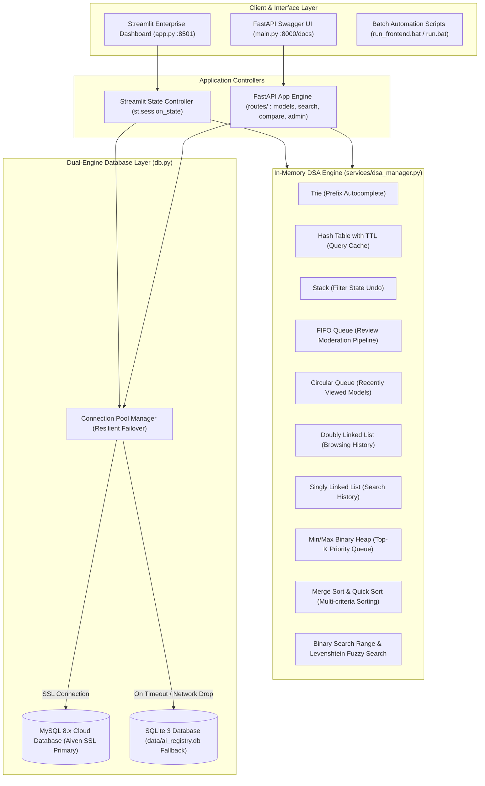

# NEXUS AI: Complete Technical Specification & System Architecture

> **System Identifier**: `NEXUS-AI-FRONTIER-REGISTRY`  
> **Core Purpose**: Enterprise Intelligence, Benchmarking, Cost Optimization, and Relational Registry for Frontier AI Foundation Models  
> **Engineering Disciplines**: Relational Database Management Systems (DBMS 3NF) & In-Memory Data Structures and Algorithms (DSA)  
> **Tech Stack**: Python 3.10+, MySQL 8.x / SQLite 3, Streamlit, FastAPI, Altair Analytics

---

## 1. Executive Summary & Problem Domain

### The Problem
Selecting frontier AI foundation models (LLMs) for production engineering is fragmented. Engineering teams must evaluate trade-offs across:
- **Financial Cost**: Input vs. output token pricing variations ($0.10 to $30.00+ per 1M tokens).
- **Memory Boundaries**: Context window capacities (8k to 2,000,000+ tokens).
- **Latency & Output Boundaries**: Maximum output token generation limits.
- **Academic vs. Real-World Capability**: Reasoning benchmarks (MMLU, GPQA Diamond, GSM8K, HumanEval) vs. human preference (Chatbot Arena Elo).
- **Operational Integration**: Function calling/tool-use, multimodal image ingestion, and API gateway rate limits.

### The Solution: NEXUS AI
**NEXUS AI** serves as a centralized intelligence registry and benchmarking clearinghouse. It unifies:
1. A **Third Normal Form (3NF) relational database** tracking 100 frontier models across 17 tables, 6 views, 3 triggers, and 5 stored procedures.
2. A **pure-Python Data Structures & Algorithms (DSA) engine** managing state, caching, search trees, priority queues, and sorting in memory.
3. An **interactive SaaS platform** (Streamlit & FastAPI) providing real-time model comparison, token spend simulation, task matching, review moderation, and live SQL auditing.

---

## 2. High-Level System Architecture



---

## 3. Database Specification (DBMS)

The database strictly conforms to **Third Normal Form (3NF)** with explicit foreign keys, domain constraints, cascading updates/deletes, and normalized data distributions.

### A. The 17 Relational Tables

| # | Entity Table | Primary Key | Foreign Keys / Constraints | Description |
|---|---|---|---|---|
| 1 | `providers` | `provider_id` | `UNIQUE(name)` | AI labs and research organizations (OpenAI, Anthropic, Google, Meta, DeepSeek, xAI, etc.). |
| 2 | `model_families` | `family_id` | `provider_id` → `providers.provider_id` (CASCADE) | Model lineages (e.g., GPT, Claude, Gemini, Llama, DeepSeek-V). |
| 3 | `model_versions` | `version_id` | `family_id` → `model_families`, `parent_version_id` → `model_versions` | Model releases storing context length, modalities, reasoning flags, release date, and status. |
| 4 | `pricing_history` | `pricing_id` | `version_id` → `model_versions` (CASCADE) | Token pricing ledger per 1M input/output tokens with currency and effective timestamp. |
| 5 | `capabilities` | `capability_id` | `UNIQUE(name)` | Master capability definitions (Function Calling, Reasoning, Vision, Audio, Structured Outputs). |
| 6 | `model_capabilities` | `(version_id, capability_id)` | Composite PK; FKs to both parent tables | M:N mapping of models to capabilities with proficiency ratings (`basic`, `proficient`, `excellent`). |
| 7 | `benchmarks` | `benchmark_id` | `UNIQUE(name)` | Academic and preference evaluation suites (MMLU, HumanEval, GSM8K, Arena Elo, GPQA Diamond). |
| 8 | `benchmark_scores` | `score_id` | `version_id` → `model_versions`, `benchmark_id` → `benchmarks` | Quantitative evaluation scores, max score bounds, and evaluation dates. |
| 9 | `use_cases` | `use_case_id` | `UNIQUE(name)` | Enterprise business workloads (Coding, Customer Support, Financial Extraction, Literature Review). |
| 10 | `model_use_cases` | `(version_id, use_case_id)` | Composite PK; FKs to both parent tables | M:N workload suitability rating (0.00 to 1.00) with production implementation notes. |
| 11 | `tags` | `tag_id` | `UNIQUE(name)` | Categorical tags (Open-Source, MoE, Proprietary, Vision, Budget, Flagship). |
| 12 | `model_tags` | `(version_id, tag_id)` | Composite PK; FKs to both parent tables | M:N categorical indexing. |
| 13 | `user_reviews` | `review_id` | `version_id` → `model_versions` | Community peer reviews with star ratings (1-5), titles, comments, and `is_approved` status. |
| 14 | `error_reports` | `error_id` | `version_id` → `model_versions` | Incident tracking for hallucinations, refusals, timeouts, and execution errors with severity levels. |
| 15 | `comparison_logs` | `comparison_id` | `model_a_id`, `model_b_id` → `model_versions` | Telemetry recording user-selected model pairs for head-to-head comparison. |
| 16 | `search_logs` | `log_id` | Indexed session tracking | Audit of search queries, filter parameter distributions, and response execution times. |
| 17 | `api_endpoints` | `endpoint_id` | `version_id` → `model_versions` (UNIQUE) | Production API gateway URLs, authentication protocols (`Bearer Token`, `API Key`), and rate limits (RPM). |

### B. 6 SQL Views
1. **`v_model_full_details`**: Flattens `model_versions`, `model_families`, `providers`, and latest `pricing_history` into a single queryable entity.
2. **`v_top_rated_models`**: Computes aggregated star ratings and approved review volumes per model.
3. **`v_free_models`**: Filters models offering free developer access or $0.00 input/output pricing.
4. **`v_model_benchmark_summary`**: PIVOT matrix aligning scores for MMLU, HumanEval, GSM8K, Chatbot Arena, and GPQA Diamond side-by-side.
5. **`v_provider_statistics`**: Aggregates provider portfolios, total active models, average input prices, and min/max ranges.
6. **`v_model_comparison_ready`**: Normalized payload designed for client-side comparison rendering.

### C. 3 Database Triggers
1. **`trg_validate_pricing`** (*BEFORE INSERT on `pricing_history`*): Rejects negative prices via `SIGNAL SQLSTATE '45000'`.
2. **`trg_review_rating_check`** (*BEFORE INSERT on `user_reviews`*): Enforces 1 <= rating <= 5 and sanitizes input whitespace.
3. **`trg_log_model_status_change`** (*AFTER UPDATE on `model_versions`*): Records lifecycle status changes (`active`, `deprecated`, `preview`) into the audit log.

### D. 5 Stored Procedures
1. **`sp_search_models`**: Multi-criteria search handling keyword matching, free-tier filtering, context window limits, max pricing, and capability tags.
2. **`sp_compare_models`**: Returns a triple result set (model specifications, Model A benchmarks, Model B benchmarks) in one execution.
3. **`sp_get_top_models`**: Extracts top K models sorted by price, context window, release date, or ratings.
4. **`sp_recommend_model`**: Matches enterprise use cases against `model_use_cases`, budget ceiling, and context window.
5. **`sp_provider_report`**: Generates organizational profile metrics and full catalog inventory for a target AI vendor.

### E. Dual-Engine Failover Architecture
The database manager in `db.py` implements an enterprise failover pattern:
- **Primary**: Connects to MySQL 8.x hosted on Aiven Cloud with SSL certificate verification.
- **Failover**: If the cloud host is unreachable, DNS times out, or the connection drops mid-query, `db.py` catches the exception and falls back to a local SQLite database (`data/ai_registry.db`) populated with the identical schema and 2,260+ records.
- Stored procedures are mirrored in SQLite through Python emulation functions (`_emulate_procedure_sqlite`).

---

## 4. Data Structures & Algorithms Specification (DSA)

To optimize latency and avoid round-trip database queries for repetitive user interactions, the platform integrates **12 data structures and algorithms** implemented in pure Python (`dsa/`):

| Algorithm / Data Structure | Module | Theoretical Complexity | Role in System Architecture |
| :--- | :--- | :--- | :--- |
| **Trie (Prefix Tree)** | `dsa/trie.py` | Insertion: $O(L)$<br>Search: $O(L)$<br>Prefix: $O(P + K)$ | Powers instant search autocomplete as user types model names. |
| **Hash Table with TTL** | `dsa/hash_table.py` | Lookup: $O(1)$ avg<br>Insert: $O(1)$ avg | Caches query responses with TTL expiration to prevent database strain. |
| **Stack (LIFO)** | `dsa/stack.py` | Push: $O(1)$<br>Pop: $O(1)$ | Manages multi-criteria filter history; powers the "Undo Previous Filter" feature. |
| **FIFO Queue** | `dsa/queue_ds.py` | Enqueue: $O(1)$<br>Dequeue: $O(1)$ | Manages incoming community reviews awaiting moderation in strict arrival order. |
| **Circular Queue** | `dsa/circular_queue.py` | Enqueue: $O(1)$<br>Dequeue: $O(1)$ | Fixed-capacity ring buffer (size 10) tracking recently inspected models per session. |
| **Doubly Linked List** | `dsa/doubly_linked_list.py` | Step: $O(1)$<br>Append: $O(1)$ | Maintains bidirectional browsing cursor (Back/Forward model navigation). |
| **Singly Linked List** | `dsa/linked_list.py` | Append: $O(1)$<br>Traversal: $O(N)$ | Maintains chronological user search query history. |
| **Min-Heap & Max-Heap** | `dsa/priority_queue.py` | Push: $O(\log N)$<br>Pop: $O(\log N)$<br>Top-K: $O(N \log K)$ | Extracts the top K cheapest or highest-rated models without sorting the full dataset. |
| **Merge Sort** | `dsa/sorting.py` | Time: $O(N \log N)$<br>Space: $O(N)$ (Stable) | Sorts model catalog across multiple fields (cost, context length, rating). |
| **Quick Sort** | `dsa/sorting.py` | Time: $O(N \log N)$ avg<br>Space: $O(\log N)$ | In-place sorting engine for benchmark score distributions. |
| **Binary Search** | `dsa/searching.py` | Lookup: $O(\log N)$<br>Range: $O(\log N + K)$ | Sub-millisecond lookup in pre-sorted catalog arrays; extracts price range brackets $[P_{\min}, P_{\max}]$. |
| **Fuzzy Search** | `dsa/searching.py` | Distance: $O(M \times N)$ | Dynamic programming (Levenshtein distance) for typo-tolerant model lookup. |

---

## 5. Application Modules & Functional Scope

The web application exposes 7 dedicated operational workspaces:

### 1. 🔍 Model Directory & Multi-Criteria Filtering
- **Search Bar**: Real-time Trie autocomplete suggestions rendered as clickable query pills.
- **Filter Matrix**: AI Laboratory multi-select, free-tier toggle, max input price slider ($0 to $25), context window threshold (8k to 1M+), and capability checkboxes (Tool Use, Reasoning, Vision).
- **Stack Undo**: The "⏪ Undo Previous Filter" button pops the prior filter configuration from the session Stack.
- **Dual Display Modes**:
  - *Grid Cards*: Modern dark cards showing pricing per 1M tokens, capability badges, and direct navigation buttons (`Deep Profile`, `Add Compare`).
  - *Detailed Data Table*: Structured table with formatted token pricing, rating badges, and capability indicators.
- **Pagination**: Client-side pagination (12 models per page) for navigation through large catalogs.

### 2. ⚖️ Head-to-Head Comparison & Cost Estimator
- **Side-by-Side Analysis**: Compares Model A (Primary) against Model B (Challenger) across token pricing, context lengths, output capacities, and reasoning proficiencies.
- **Production Spend Simulator**: Accepts user monthly token projections (Millions of Input Tokens and Millions of Output Tokens) and calculates:
  $$\text{Monthly Cost} = (\text{Input Tokens} \times P_{\text{in}}) + (\text{Output Tokens} \times P_{\text{out}})$$
  Outputs monthly bills for both models, highlights net dollar savings, and computes percentage efficiency deltas.
- **Grouped Benchmark Bar Chart**: Visualizes scores across MMLU, HumanEval, GSM8K, and GPQA Diamond side-by-side using Altair.
- **Chatbot Arena Elo**: Side-by-side card for human-preference arena ratings.

### 3. 🏆 Performance Leaderboard
- **Suite Switcher**: Ranks all cataloged models across verified evaluation suites (Chatbot Arena Elo, MMLU, HumanEval, GSM8K, GPQA Diamond).
- **Visual Analytics**: Altair horizontal gradient bar chart plotting model performance against maximum score bounds.
- **Ranked Table**: Displays gold, silver, and bronze rank medals (🥇, 🥈, 🥉) with raw scores, normalized percentages, and pricing.

### 4. 🤖 Deep Model Profile & Technical Audit
- **Architecture Overview**: Provider identity, country of origin, open-source license status, external ID, and description.
- **5 Detailed Sub-Tabs**:
  1. *Capabilities Matrix*: Explicit proficiency levels (Excellent, Proficient, Basic) across reasoning, coding, and tool calling.
  2. *Pricing Tiers*: Chronological pricing history ledger with effective dates.
  3. *Benchmark Performance*: Complete quantitative academic scores.
  4. *Enterprise Workloads*: Suitability ratings (1-100%) for production use cases.
  5. *API Gateway*: Production endpoint URL, authentication protocol, rate limits (RPM), and a copy-paste Python integration snippet.
- **Session Telemetry**: Automatically appends viewed models to the session's Circular Queue ring buffer.

### 5. 💡 Smart Cost & Task Matcher
- **Workload Selector**: Matches business tasks against database records (*Software Engineering & Coding*, *Customer Support*, *Financial Extraction*, *Academic Research*).
- **Constraint Selectors**: Budget ceiling slider and context window limits.
- **Stored Procedure Integration**: Executes `sp_recommend_model` to return the most cost-effective and capable models.

### 6. 💬 Developer Reviews & Moderation Hub
- **Write a Review**: Form submitting star ratings (1-5) and text directly into `user_reviews` while enqueuing into the FIFO Queue DSA.
- **Moderation Feed**: Displays pending reviews; enables one-click approval (updates `is_approved = 1`) or rejection (deletes record) while dequeuing from the FIFO Queue.
- **Incident & Bug Tracker**: Logs hallucinations, timeouts, and execution errors directly into `error_reports`.

### 7. ⚙️ Enterprise SQL Console & Database Inspector
- **Table Distribution Chart**: Real-time bar chart showing row counts across all 17 tables (2,260+ records).
- **1-Click SQL Templates**: Quick queries for *"Top 10 Cheapest Models"*, *"Highest Context"*, *"Arena Elo Leaderboard"*, and *"Recent Reviews"*.
- **Interactive SQL Terminal**: Runs custom `SELECT` queries with sub-millisecond execution timers ($t_{\text{latency}}$ in ms) and exportable data tables.

---

## 6. API Reference (FastAPI Backend)

For headless or programmatic access, the backend exposes 18 REST endpoints on `http://localhost:8000`:

| Method | Endpoint | Description | Implementation |
| :--- | :--- | :--- | :--- |
| `GET` | `/` | System overview, DBMS specifications, and DSA capabilities | Dynamic System Metadata |
| `GET` | `/api/models` | List models with multi-criteria filtering and DSA sorting | Merge Sort / Quick Sort |
| `GET` | `/api/models/{id}` | Complete model profile across 7 relational tables | SQL View `v_model_full_details` |
| `GET` | `/api/models/top/ranked` | Top-K models extracted by rating, cost, or context | Min/Max Heap ($O(N \log K)$) |
| `GET` | `/api/search/autocomplete` | Sub-millisecond prefix suggestions | Trie ($O(L)$) |
| `GET` | `/api/search/range` | Fast price bracket extraction | Binary Search Range ($O(\log N)$) |
| `GET` | `/api/search/fuzzy` | Typo-tolerant keyword search | Levenshtein Distance ($O(M \times N)$) |
| `GET` | `/api/search/advanced` | Stored procedure execution | Procedure `sp_search_models` |
| `GET` | `/api/compare` | Head-to-head comparison matrix | Procedure `sp_compare_models` |
| `GET` | `/api/compare/recommend` | Task-based recommendation | Procedure `sp_recommend_model` |
| `GET` | `/api/benchmarks/leaderboard` | Ranked leaderboard for target benchmark suite | SQL View `v_model_benchmark_summary` |
| `POST`| `/api/reviews` | Submit developer review | Inserts to DB & enqueues to FIFO Queue |
| `GET` | `/api/reviews/moderation/pending`| Inspect next pending review in pipeline | Queue Peek ($O(1)$) |
| `POST`| `/api/reviews/moderation/action` | Approve or reject review | DB update & Queue Dequeue ($O(1)$) |
| `POST`| `/api/reviews/errors` | Log production hallucination/incident | Inserts to `error_reports` |
| `GET` | `/api/admin/stats` | Live counts across all 17 database tables | Aggregate DB Queries |
| `POST`| `/api/admin/rebuild-indexes` | Rebuilds in-memory Trie and sorted binary arrays | In-Memory DSA Re-indexing |

---

## 7. Operational Runbook

### Environment Prerequisites
- Windows 10/11 (or Linux/macOS)
- Python 3.10 to 3.14
- Virtual environment with dependencies (`streamlit`, `fastapi`, `uvicorn`, `mysql-connector-python`, `altair`, `pandas`, `numpy`)

### Execution Commands

#### 1. Interactive Streamlit Dashboard (Primary User Interface)
```cmd
cd /d "D:\dbms proejcct"
run_frontend.bat
```
*Or directly via Python:*
```cmd
venv\Scripts\python.exe -m streamlit run app.py
```
*URL*: `http://localhost:8501`

#### 2. REST API Engine & Interactive Swagger Documentation
```cmd
cd /d "D:\dbms proejcct"
venv\Scripts\python.exe -m uvicorn main:app --reload --host 0.0.0.0 --port 8000
```
*Swagger Documentation URL*: `http://localhost:8000/docs`

#### 3. Automated Test Suite (Verifies 17 Tables & 12 DSA Algorithms)
```cmd
cd /d "D:\dbms proejcct"
venv\Scripts\python.exe test_api.py
```
*Expected Result*: **`ALL 9 TEST SUITES PASSED FLAWLESSLY!`** (Exit code `0`).

---

## 8. Applied Bug Fixes & Architectural Decisions

1. **Windows CMD QuickEdit Suspension**:
   - *Issue*: Clicking inside a Windows Command Prompt causes it to enter `Select` mode, suspending Python process execution and causing the browser connection to hang.
   - *Fix*: Set `headless = false` in `.streamlit/config.toml` and added auto-launch `start http://localhost:8501` in batch scripts so the user does not need to click inside the terminal.
2. **Numeric Type Compatibility**:
   - *Issue*: MySQL `DECIMAL` fields return `decimal.Decimal` objects, which fail when multiplied by Python `float` inputs.
   - *Fix*: All pricing figures in the production cost estimator are explicitly cast (`float(m1['input_price'] or 0.0)`) before arithmetic operations.
3. **Streamlit Duplicate Widget Keys**:
   - *Issue*: Viewing the same model multiple times added duplicate entries to recent history, causing Streamlit duplicate key collisions (`rec_nav_{id}_{name}`).
   - *Fix*: Implemented in-memory deduplication preserving recency order, and prefixed unique enumeration indices (`key=f"rec_nav_{idx}_{v_id}"`).
4. **Resilient Unicode Console Compatibility**:
   - *Issue*: Unicode emojis in error logging prints caused `UnicodeEncodeError` crashes on Windows CP1252 consoles.
   - *Fix*: Replaced Unicode emojis in database error-handling routines with standard ASCII prefixes (`[!]`, `[*]`).
